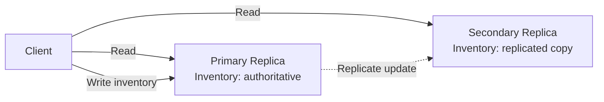
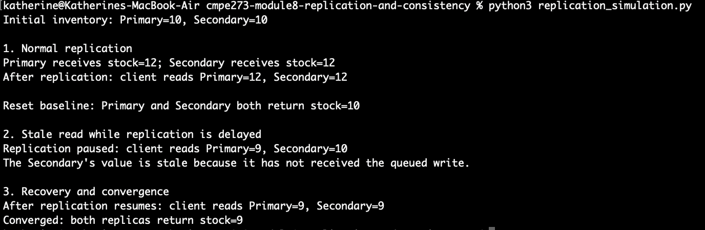

# cmpe273-module8-replication-and-consistency

## Instructions:

```sh
python3 replication_simulation.py
```

## Architecture



When replication is paused, the Primary queues updates until it resumes.

## Successful replication, stale-read test, and replicas converging after replication resumes:


## Reflection:
Reading from a replica will be faster than reading from the latest value. However, while reading from the replica can be faster to get a response, it may mean that the data is outdated and thus inaccurate. Reading from the latest value takes longer because we have to wait for the replication to confirm the read. This tradeoff between speed and accuracy means we should decide which is more important for the business needs of the service.